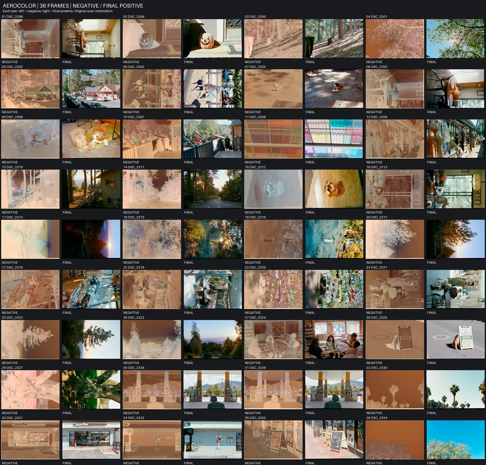

# Film Negative Skill

An instruction-only agent skill for developing scanned or camera-digitized film negatives with **darktable-cli** and **negadoctor**. It covers roll-specific film-base calibration, scene-aware color correction, independent edit histories, preview approval, and user-directed delivery.

No bundled scripts, Python dependency, or universal film-stock preset. Install darktable separately; a GUI-authored sidecar may be required if the installed module schema cannot be verified safely.

## Install

Install with the Skills CLI:

```sh
npx skills add Microwave-WYB/film-negative-skill
```

Inspect discovery without installing:

```sh
npx skills add Microwave-WYB/film-negative-skill --list
```

For a local checkout, run `npx skills add /path/to/film-negative-skill --list`. The discovered skill is named `film-negative`.

## Use

Read [SKILL.md](SKILL.md), then ask your agent, for example:

> Develop these film scans using darktable. Preserve originals and existing edits, calibrate from this roll's film base, and show color-managed previews before batch export. Ask me to approve the look, frame selection, and orientations first.

The workflow requires an installed `darktable-cli` with negadoctor support. Inspect the installed version and matching documentation before changing module parameters. The CLI applies a verified XMP edit history.

See the official [CLI manual](https://docs.darktable.org/usermanual/development/en/special-topics/program-invocation/darktable-cli/) and [negadoctor manual](https://docs.darktable.org/usermanual/development/en/module-reference/processing-modules/negadoctor/).

## Effect preview

One Aerocolor roll, shown as **36 negative/positive thumbnail pairs** in original scan orientation.



## License

[MIT](LICENSE).
